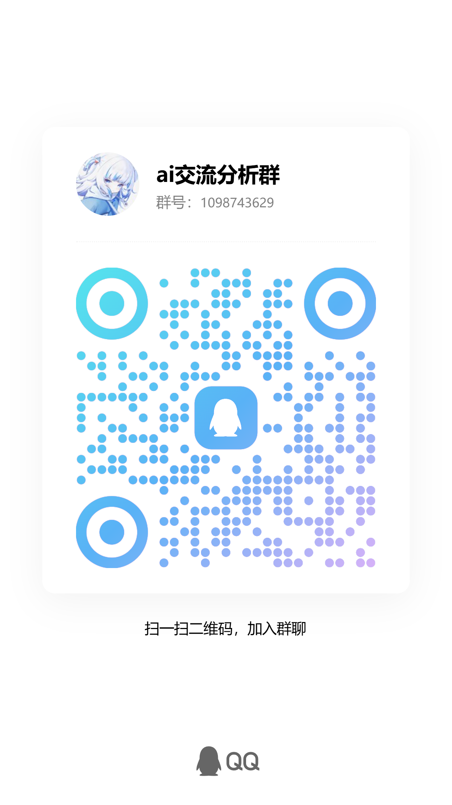
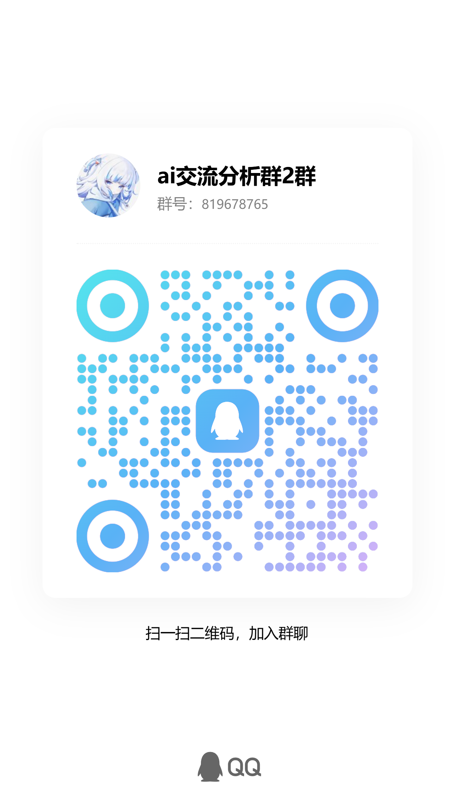
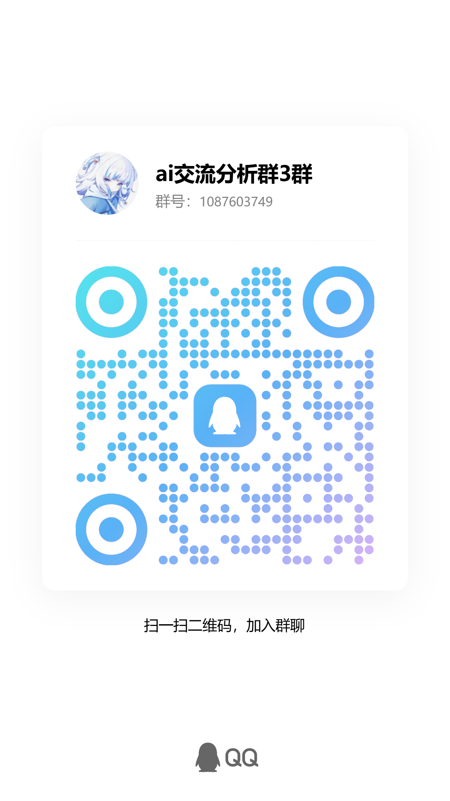
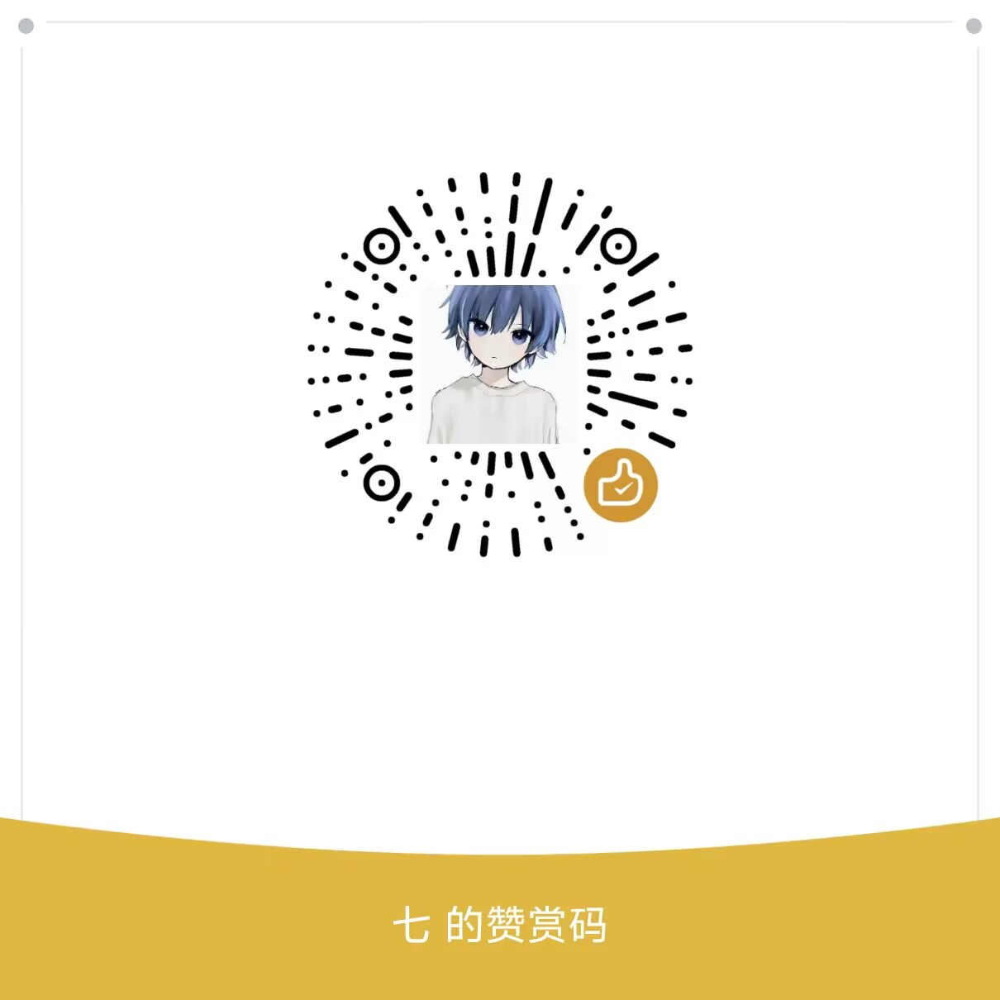

# 寒霜破甲工具（hanshuang）

仓库地址：https://github.com/3722593qq/hanshuang-free-start-bat

一个开源的 Electron 桌面工具：把同一套「破甲」提示词与逆向技能库，一键安装 /
卸载 / 还原到 9 个 AI 客户端，并内置 Seep 逆向工作台（Radare2 / JADX / Apktool /
Frida 封装 + 战术知识库）的部署与自检。

- 提示词正文不内置：由用户自己放进 `memory/` 目录，安装时按目标注入。
- 随包的 Seep 逆向工作台以 **git submodule** 形式引用上游仓库，主仓库保持干净。

---

## 功能

| 能力 | 入口 | 说明 |
|---|---|---|
| 安装 | 各目标页的安装按钮 | `install*.ps1 -SourcePrompt memory/破甲记忆.md` + 随包技能库 |
| 卸载 | 各目标页的卸载按钮 | `install*.ps1 -Uninstall` + `clear-injected-prompts.ps1` 兜底清扫 |
| 装回原始记忆 | 各目标页的「装回原始记忆」 | 还原安装前备份，技能库保留 |
| Skills 管理 | Skills 管理页 | 查看 / 启停本机 Codex 技能 |
| Seep 工作台 | Seep 逆向工作台页 | 部署 / 自检 / 卸载整条逆向工具链 |
| 一键启动 | `start.bat` / `start.sh` | 桌面端双击即用，自动处理 Electron 环境坑 |

九个目标页：Codex / ZCode / Cursor / OpenCode / Claude / WorkBuddy 国际版 /
WorkBuddy 国内版 / DeepSeek Harness / 豆包。

- OpenCode 注入点：`~/.config/opencode/AGENTS.md`（可用 `XDG_CONFIG_HOME` 改），
  技能落 `~/.config/opencode/skills`。
- 记忆文件为空时安装会**直接报错**，不会写入半成品。
- 卸载与还原不依赖随包提示词文件；用户自己写进 `AGENTS.md` / `CLAUDE.md` /
  记忆档案的内容一律保留。

## 快速开始

### 普通用户（源码运行）

```bash
npm install
npm run build
./start.sh          # macOS / Linux / Git Bash
# Windows：双击 start.bat
```

`start.bat` / `start.sh` 会自动清理 `ELECTRON_RUN_AS_NODE`（否则 electron.exe 会
退化成纯 Node，`require('electron')` 拿不到 `app`，启动即崩），并在 `dist/` 缺失时
先自动构建。

### 开发者

```bash
npm install
npm run dev         # Vite 开发服务器
npm run build       # 只构建渲染层到 dist/
npx electron .      # 跑起来（默认加载 dist/）
HS_DEV=1 npx electron .   # 连开发服务器
```

> 在已被注入 `ELECTRON_RUN_AS_NODE=1` 的环境里，先 `unset ELECTRON_RUN_AS_NODE`
> （或置空）再启动。

## 打包

```bash
npm run dist
```

产物落在 `release/`：

- `寒霜破甲工具-便携版-<版本>.zip` —— 由 `win-unpacked` 直接打包，解压即用，
  启动约 2 秒（唯一产物，不出安装器）。

便携版没有安装器，删文件夹不等于卸载干净：`portable-uninstall.ps1` + 同目录
`卸载-便携版.bat` 会一并清掉 `%APPDATA%\hanshuang-free`、状态文件和快捷方式。

## Seep 逆向工作台（submodule）

`seep-kit/` 是原样引用的
[Seep-Reverse-Lab](https://github.com/angusdevgo/Seep-Reverse-Lab)（GPL-3.0）：
MCP 服务、9 个技能、战术知识库、案例与 MANUAL 手册。

```bash
# 克隆本项目时带上 submodule
git clone --recursive https://github.com/3722593qq/hanshuang-free-start-bat.git

# 已经克隆过、想补拉 submodule
git submodule update --init --recursive
```

界面上的「部署工作台」执行 `seep-kit/setup/install.ps1 -NonInteractive`；
「自检」与「卸载」分别走 `setup/verify.ps1 -Detailed` 与 `setup/uninstall.ps1 -Yes`。

## 目录

```
electron/     主进程、preload、PowerShell 调度、压缩守护、WorkBuddy 记忆守护
src/          渲染层（React）
  pages/      破甲详情页 / Skills 管理 / 使用教程 / 个人中心
  styles/     PI-Desktop 的样式表 + app.css
  assets/     界面用的字标图
scripts/      构建与图标脚本
build/        图标源文件（png / ico）
install*.ps1  清理脚本（卸载 / 装回原始记忆，打包时随 extraResources 进包）
seep-kit/     引用的 Seep 逆向工作台（git submodule）
memory/       自己的提示词 / 记忆，安装时注入（打包时随 extraResources 进包）
start.bat     一键启动（Windows）
start.sh      一键启动（bash）
```

## 开源许可

- **本仓库代码**：MIT，见 [LICENSE](LICENSE)。
- **`seep-kit/`**：GPL-3.0，属第三方 Seep-Reverse-Lab，许可以其自身 `LICENSE`
  为准。MIT 不覆盖该 submodule，再分发或嵌入产品前请先阅读其许可条款。

## 免责声明

本项目仅供**安全研究与授权范围内**的学习、演练与防御性分析使用。请勿将其用于
未授权的系统、服务或数据。使用本项目的一切后果由使用者自行承担，作者与贡献者
不对任何滥用行为负责。

## 交流群

| ai交流分析群 | ai交流分析群2群 | ai交流分析群3群 |
|:---:|:---:|:---:|
|  |  |  |
| 群号：1098743629 | 群号：819678765 | 群号：1087603749 |

## 友链

- [LinuxDo](https://linux.do) — 真诚、友善、团结的中文技术社区

## 赞赏

如果这个项目碰巧对你有一点点帮助，愿意的话可以请作者喝杯咖啡……当然，不赞赏也
完全没关系，项目会一直免费开源下去的。

| 微信赞赏 | 支付宝收款 |
|:---:|:---:|
|  |  |

## License

MIT — 见 [LICENSE](LICENSE)
